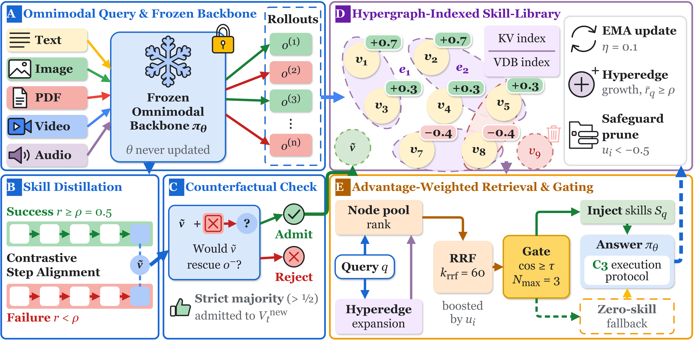

# HyperSkill

HyperSkill: Training-Free Omnimodal GRPO via Hypergraph-Indexed Skill-Library Evolution

## Overview



## Quick Start

### 1. Environment Setup

```bash
conda create -n hyperskill python=3.13 -y
conda activate hyperskill
pip install -r requirements.txt
```

All models (backbone `google/gemini-2.5-flash-lite`) are accessed through [OpenRouter](https://openrouter.ai/); create an API key at https://openrouter.ai/keys and set it as `OPENROUTER_API_KEY`:

```bash
export OPENROUTER_API_KEY="your_openrouter_key_here"
```

### 2. Data Preparation

Download the data from [Hugging Face](https://huggingface.co/datasets/LHRLAB/HyperSkill) into `dataset/` (or set `HYPERSKILL_DATA_DIR=/path/to/dataset`), then build the document index:

```bash
hf download LHRLAB/HyperSkill --repo-type dataset --local-dir dataset
pip install rapidocr-onnxruntime==1.2.3
python scripts/build_doc_index.py --dataset MMLongBench-Doc --ocr
python scripts/build_doc_index.py --dataset DocBench
```

### 3. Implementation

```bash
bash scripts/train.sh
bash scripts/eval.sh
```

`scripts/train.sh` evolves the skill library of each of the 11 datasets from its training split with the configuration in [`configs/final_configs.json`](configs/final_configs.json) and writes it to `expr/hs_skill_library/<dataset>/`. `scripts/eval.sh` evaluates the learned libraries on the test splits with the same configuration, writes the per-question records to `outputs/hs_hyperskill_<dataset>/eval_results.json`, and prints the F1 scores. Both run all datasets in parallel; to run selected datasets, pass their names, e.g. `bash scripts/train.sh AIME2024 WorldSense` and `bash scripts/eval.sh AIME2024 WorldSense`.

## BibTeX

If you find this work is helpful for your research, please cite:

```bibtex
@inproceedings{luo2026hyperskill,
 author = {Luo, Haoran and Lin, Shangkai and Wu, Jinyang and Zhou, Xinliang and Luu, Anh Tuan},
 booktitle = {Advances in Neural Information Processing Systems},
 title = {HyperSkill: Training-Free Omnimodal GRPO via Hypergraph-Indexed Skill-Library Evolution},
 year = {2026}
}
```

For further questions, please contact: haoran.luo@ntu.edu.sg.

## Acknowledgment

This repo benefits from [Training-Free GRPO](https://github.com/TencentCloudADP/youtu-agent), [HyperGraphRAG](https://github.com/LHRLAB/HyperGraphRAG), and [Graph-R1](https://github.com/LHRLAB/Graph-R1). Thanks for their wonderful works.
